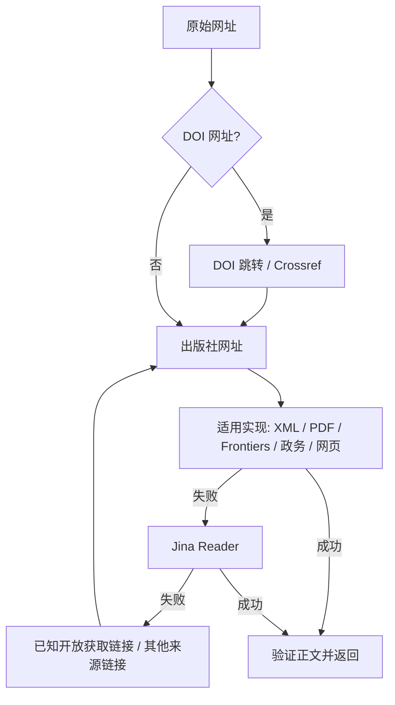

# 原文获取工具

实现位于 `backend/app/services/fulltext/`，与数据库、评分服务独立。单篇重抓、显式批量抓取及自动正文回补共用这一套工具。

`FulltextFetcher` 是抽象类，实现 `supports(url)` 和异步 `fetch(url, context)`。`FulltextEngine` 按 `priority` 从小到大选择实现；下载或解析失败会继续尝试后续方法。一次获取共用 HTTP 客户端、下载缓存、失败记录和总时限。

| 实现类 | 适用网址 | 获取方法 |
| --- | --- | --- |
| `DoiFetcher` | `doi.org`、`dx.doi.org` | 解析跳转到出版社；解析失败时查询 Crossref 的出版社地址，再交给对应实现 |
| `PdfFetcher` | `.pdf`、`/pdf` | 下载 PDF，用 pypdf 提取文字层 |
| `JatsXmlFetcher` | `.xml`、`/xml`、`/xml/nlm`、`/fulltextxml` | 解析 JATS 正文、章节、摘要、表格与参考文献，拒绝只有摘要的 XML |
| `FrontiersFetcher` | `frontiersin.org` | 从出版页的 citation 元数据找到全文，优先 XML，再 PDF，最后提取网页 |
| `GovernmentHtmlFetcher` | `*.gov.cn` | 直连网页并提取正文；广西农业农村厅已验证站点遇 TLS 错误时重试同路径 HTTP |
| `HtmlFetcher` | 其他 HTTP(S) 网址 | 用 Trafilatura 提取正文；学术网页也优先尝试 citation XML / PDF，并识别实际返回的 PDF、XML 和纯文本 |
| `JinaFetcher` | 解析后的网页、文件网址 | 通过配置的 Jina Reader 获取 Markdown，作为最后的补充方法 |



候选链接依次取文章的 `url`、`paper.oa_url`、`source_url`，去重并忽略无效候选；默认最多尝试 8 个链接。DOI 先解析到出版社，避免直接把 DOI 域名交给 Reader 后遇到域名封禁。原文抓取不改写文章的原始 URL。

## 独立调用

从 `backend/` 运行，安装 `requirements.txt` 后可直接使用，无需启用数据库或模型服务：

```python
import asyncio
from app.services.fulltext import FulltextEngine, FetchOptions, FulltextFetchError

async def main():
    engine = FulltextEngine(options=FetchOptions(timeout=60, max_chars=100_000))
    try:
        result = await engine.fetch(
            "https://doi.org/10.3389/fsufs.2026.1904226",
            alternative_urls=[],  # 可传入已知开放获取网页或 PDF
        )
    except FulltextFetchError as error:
        print(error.reason, error.upstream_status, error.attempts)
        return
    print(result.fetcher, result.source_url, result.truncated)
    print(result.text)

asyncio.run(main())
```

返回的 `FetchResult` 包含 Markdown / 文本正文 `text`、实际获取地址 `source_url`、方法 `fetcher`、是否截断 `truncated`，以及失败尝试 `attempts`。例如 DOI 转到 Frontiers XML 时，方法为 `doi>frontiers_xml`。

应用层的 `content_service.fetch_fulltext_result()` 使用环境配置创建工具；`fetch_item_fulltext(item)` 还负责补充文章的候选链接。原有 `fetch_fulltext()` 继续返回文本或 `None`，手动操作设置 `raise_errors=True` 获取可读错误。应用层抓取遵循后台的启用开关。

## 添加站点实现

以下为接口示例；把域名、解析逻辑换成目标站点的规则，在 `content_service.create_fulltext_engine()` 中注册即可让业务入口使用它。

```python
import asyncio
from urllib.parse import urlsplit
from app.services.fulltext import FulltextFetcher, FetchContext, FetchResult, FulltextEngine
from app.services.fulltext.fetchers import require_success
from app.services.fulltext.extractors import extract_html

class ResearchSiteFetcher(FulltextFetcher):
    name = "research_site"
    priority = 40

    def supports(self, url: str) -> bool:
        return urlsplit(url).hostname == "research.example"

    async def fetch(self, url: str, context: FetchContext) -> FetchResult:
        response = await context.get(url)
        require_success(response)
        # 可在此按站点规则调用全文接口、定位正文节点或寻找下载链接。
        text = await asyncio.to_thread(extract_html, response.content, str(response.url))
        return FetchResult(text, str(response.url), self.name)

engine = FulltextEngine()
engine.register(ResearchSiteFetcher())
```

实现应通过 `context.get()` 下载，复用重定向验证、大小限制与缓存；需要再次选择实现时可以调用 `await context.follow(target_url)`。提取失败抛出 `FulltextFetchError`，引擎会继续回退；取消操作会正常向上传递。

## 配置与边界

- `CONTENT_FETCH_TIMEOUT=60`：整次获取的总时限，包含不同方法与候选链接。
- `CONTENT_MAX_CHARS=100000`：最多保存字符数；工具结果与成功日志会标记截断。此前 Reader 的 20,000 字符上限已提高。
- `JINA_API_KEY`：可选；直连网页、XML、PDF 不使用此密钥。`JINA_READER_BASE_URL` 可替换 Reader 服务地址。
- 单次下载默认最多 10 MiB；PDF 默认最多 100 页。正文不足 200 字符、识别到访问验证页面时不保存。
- 直连请求与重定向只允许公开 HTTP(S) 地址；不关闭 TLS 验证。只有 `nynct.gxzf.gov.cn` 的已验证同路径链接允许 HTTPS 证书失败后尝试 HTTP。
- PDF 文字层可提取；扫描件需要 OCR。付费、登录或反爬限制的原文仍可能失败。
- Jina 的 `40305 / AbuseAlleviationError` 归为 `reader_domain_blocked`，与密钥鉴权错误区分。接口继续返回 `reason`、`upstream_status`；工具结果记录各次失败的方法，不返回服务商原始错误正文。
- 抓取成功后先提交正文，再尝试评分；评分异常保留正文。抓取失败不会覆盖已有内容。自动文献入库继续使用摘要/卡片，手动或显式批量抓取支持论文全文。

## 验证

真实来源验证：`10.3389/fsufs.2026.1904226` 经 DOI → Frontiers XML 得到 **75,703 字符**，未截断；直接解析同一篇 PDF 得到 **81,880 字符**。广西农业农村厅 `t28253108.shtml` 经政务网页直连及 HTTP 回退得到 **1,867 字符**。

5551 在独立临时数据库中完成单篇接口保存及公开接口回读，均返回 200，正文一致，原始 DOI、摘要与论文元数据保留。后端全量测试 **240 passed、2 skipped**（包含专用真实 PostgreSQL 检查）；前端生产构建通过。

单元与接口测试覆盖 DOI / Crossref、XML / PDF 解析、网页去导航、开放获取回退、Reader 域名封禁诊断、下载限制、重定向、取消、正文提交与失败保留。

```bash
backend/.venv/bin/python -m pytest backend/tests -q
```
