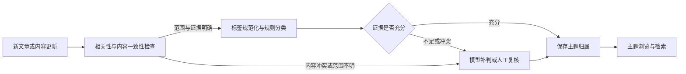

# AgriHot 主题系统升级建议

审阅日期：2026-10-22。依据：`agrihot-taxonomy-framework.md`、`agrihot-tag-mapping.csv`，以及当前工作区代码。

实现状态：一期功能已在本地完成，最终规则回放与测试结果见 [实现与验收记录](taxonomy-implementation-2026-10-22.md)。下文保留方案审阅时的数据口径和设计依据。

线上核验已完成：读取 [公开主题页](https://agrihot.com/tags)及其接口，核对全部 5,537 篇文章和 7,888 个有文章关联的标签。原 CSV 能为 5,009 篇（90.46%）产生候选归属，但 3,149 篇同时命中多个一级。完整口径、漏词、实例和 62 个二级候选量见 [线上数据核验](taxonomy-live-audit-2026-10-22.md)。这些是候选命中结果，尚不是分类准确率。

建议采用「两级主题导航 + 有类型的规范标签 + 独立检索短语」。10 个一级主题可保留为候选频道，62 个二级主题先做数据验证；优先打通分类、浏览和人工纠错，再逐步开放区域与机构筛选。

## 1. 当前系统可以复用什么

| 现有能力 | 代码位置 | 升级时的处理 |
|---|---|---|
| 文章与标签多对多，标签只有名称 | [models.py](../backend/app/models.py) | 新增主题关系，给标签增加类型和治理状态 |
| 内容类型已有「政策 / 报道 / 论文 / 行业」 | [ingest_service.py](../backend/app/services/ingest_service.py) | 继续用 `category`，避免再造一套内容类型 |
| 短标签与 `search_phrases` 已分开 | [topic_service.py](../backend/app/services/topic_service.py) | 保留实体长尾检索；新主题不替代检索短语 |
| `/tags/{name}` 支持单标签与组合检索 | [标签页](../frontend/app/pages/tags/[name].vue) | 保留链接语义；规范词别名接入同一解析器 |
| DeepSeek 评分同时重写标签 | [scoring_service.py](../backend/app/services/scoring_service.py) | 分类形成独立服务，评分只提供候选结果 |
| 论文关注方向是 `PaperMeta.direction` | [watchlist.yaml](../backend/app/watchlist.yaml) | 继续表达文献订阅方向，不直接充当全站主题 |
| 网页与 Agent 分别拼接筛选条件 | [public.py](../backend/app/api/v1/public.py)、[agent_service.py](../backend/app/services/agent_service.py) | 共用主题与分面筛选逻辑，REST / MCP 一致 |
| 标签变动会触发检索索引更新 | [search_queue.py](../backend/app/services/search_queue.py) | 为新增关系、规范词改名补充失效和重建路径 |

当前主题首页只是按数量展示全部标签；尚无真正的主题树、别名表和文章主辅归属。此次升级主要补足这三部分。

## 2. CSV 核对结果

CSV 共 62 行定义、10 个一级主题；「归入标签」按顿号拆分后有 915 条映射项，去重后 900 个词。13 个词跨二级主题出现；同一行内「智能温室」（B7）和「秋粮」（J4）各重复一次。C1、C2、C3、D4 共 4 行明确标注「需新增/补齐」。

这 900 个词是文件里的词表规模。线上核验精确匹配到 863 个现有标签，覆盖 10.94% 的标签词面；原文的「900+ 标签」「约 500 个低频词」需要修正为 7,888 个活跃标签、7,142 个少于 5 篇的低频词。词面覆盖、文章候选覆盖和分类准确率是三个不同指标。

需优先补足「精准农业」（241 篇）、「成果转化」（146 篇）、「作物表型」（32 篇）等高频遗漏，给机构词和类型词安排独立去向；不能继续把原 CSV 当作线上词表的完整映射。

| 具体问题 | 例子 | 建议修正 |
|---|---|---|
| 机构仍作为主题判定词 | A6「甘蔗所」「烟草所」、B3「茶叶所」、B5「食用菌所」、J1「农业农村部」 | 标为机构；不能只因发稿机构就确定文章主题 |
| 类型仍进入主题字典 | J1「政策」、I7「综述」、J4「会议 / 论坛 / 培训会」 | 不作为主归属充分条件；类型和活动形式分别表达 |
| 地区与机构混入国际主题 | J3「尼日利亚」「肯尼亚」「FAO」 | 拆为区域或机构；国际合作主题需要内容证据 |
| 存在需要纠正的跨域映射 | 「渔光互补」同时进入 B7 设施园艺、D5 智慧渔业 | 移除对 B7 的直接命中；结合水产、能源等上下文分类 |
| 技术词被限定到某个应用 | 「无人机」→ I3 遥感；「区块链」→ E4 溯源；「智能体」→ F6 机器人 | 增加上下文条件，避免把植保、物流、通用软件等误归类 |
| 泛词被映射到具体技术 | 「国产替代 / 自主可控」→ F2 生物育种 | 只作为弱证据，不能独立决定主题 |
| 交叉映射缺少主辅规则 | 「青贮玉米」→ A3 / C4；「绿色防控」→ F4 / H8 | 保留多候选，由文章重点决定主主题与辅主题 |
| 宽泛总词被放进窄二级 | 「畜牧业」→ C6 智慧畜牧；「水产养殖」→ D1 池塘与工厂化养殖 | 缺少技术或生产方式证据时，只归一级 |
| 方法词容易盖过研究对象 | I7「双重差分 / 中介效应 / 面板数据」 | 方法作为关键词；只有方法本身是讨论重点才进入 I7 |
| 非农业语境也可能命中 | 「考古遥感 / 城市热岛 / 智慧城市」等 | 先判断农业相关性，不能仅靠词表强行收录到主题 |

跨主题重复不全部是错误。完整的 13 个词为：玉米单产提升、青贮玉米、紫花苜蓿、饲草产业、渔光互补、订单农业、绿色防控、智能体、土地整治、耕地质量、农业绿色发展、机器视觉、空间计量。规则格式必须支持一词多个候选及各自的命中条件。

## 3. 主题、标签、类型和检索的职责

| 概念 | 用途 | 示例 |
|---|---|---|
| 一级 / 二级主题 | 稳定导航、栏目聚合、相关推荐 | 大田作物 → 水稻；数字农业 → 农业 AI |
| 有类型的规范标签 | 技术、区域、机构筛选，以及页内热词 | 农业人工智能、浙江、江苏省农科院 |
| 内容类型 `category` | 沿用当前内容分组 | 政策、报道、论文、行业 |
| 检索短语 `search_phrases` | 具体机构、对象、品种等组合查询 | 四川省农科院 薯花系列 花生 |

标签类型一期可设为 `keyword / technology / region / organization`，另用状态控制是否展示。机构、地名和长尾词仍可被搜索，但不挤进主导航。

原方案的 10 个一级主题并非全部是产业域：「数字农业」「资源环境」「政策与宏观」跨越多个产业。可以把它们明确定位为编辑频道，接受内容交叉，通过主辅归属管理，而不是宣称目录完全正交。

以一篇正文明确讨论浙江水稻生产中 AI 病害识别应用的论文为例：

| 字段 | 归属 |
|---|---|
| 主主题 | 大田作物 → 水稻 |
| 辅主题 | 数字农业与前沿技术 → 农业 AI 与大模型 |
| 技术 | 农业人工智能、计算机视觉 |
| 区域 | 浙江 |
| 类型 | 论文 |

它必须同时出现在水稻和农业 AI 的主题列表中。辅主题也参与导航检索，不能只用于相关推荐。若论文的重点是通用算法创新，水稻只是实验对象，则可以交换主辅归属。

## 4. 分类与统计规则

1. 已完成分类的文章有且仅有一个主主题，辅主题最多两个。只保存具体节点，由主题树推导其一级归属，避免同时写父子节点造成重复。
2. 优先根据文章讨论重点确定主主题。具体作物应用、通用技术方法、行业制度分别有边界；不能只按词频，或看到「政策」就放进 J。
3. 对具体产业的政策仍可归该产业，`category=政策`；J1 建议改为「政策制度与发展规划」，重点收跨产业制度和总体规划。
4. 「水稻」与「设施园艺」「生物育种」等候选冲突时，根据文章的主要信息增量选择主主题，明确辅主题，冲突不靠目录顺序消解。
5. 能确认一级、不能确认二级时，允许先归一级并标记待细分；完全不确定时进入待分类。一级覆盖率、二级细分率和复核积压分别统计。
6. 主题页聚合本节点、子节点的主辅归属，用文章 ID 去重。不同主题页数量允许交叉；后台查看内容分布时另用主归属统计，不能把频道计数相加当成全站文章数。
7. 同一筛选维度多选取 OR，不同维度取 AND。旧 `tags` 参数的全部匹配语义继续兼容；新分面参数应明确其组合规则。
8. 区域和机构必须有可追溯证据。文章讨论区域不等于机构所在地，`source_name` 是信源，不自动代表研究机构或文章对象。
9. 农业相关性与标签/内容一致性需要单独检查。线上已发现农业合作报道带材料科学标签的实例，以及没有农业应用证据的公共建筑论文；此类内容进入复核，不凭旧标签或低分直接作最终分类。

## 5. 一期数据模型与接口

| 数据 | 建议结构 |
|---|---|
| `topics`（新增） | 稳定 ID / code、slug、名称、parent_id、说明、排序、启用状态；最多两级 |
| `item_topics`（新增） | item_id、topic_id、是否主主题；文章与主题组合唯一，主主题用部分唯一索引限制为最多一个 |
| `tag_aliases`（新增） | 别名 → canonical Tag ID；别名唯一，直接指向规范词，不形成别名链 |
| `Tag`（扩展） | 标签类型、治理状态；模型生成的新词先作为候选，经过规则或人工确认才进入公开热词与分面 |
| 文章分类元数据（新增） | 状态、规则版本、分类器版本、输入哈希、判定依据、人工锁定、更新时间；与评分明细分开 |

服务层在提交一个已完成分类结果时校验「恰好一个主主题」、有效节点和辅主题上限；数据库唯一约束负责兜住并发产生多个主主题的情况。

一期用版本化 `taxonomy.yaml` 管理主题定义、收录/排除边界、别名和映射规则，幂等同步到数据库查询表。管理端先支持文章纠错；主题字典不同时在 YAML 和后台两处编辑。

CSV 转规则时至少补足：规则 ID、目标主题、角色候选、标签精确命中、文本命中、必要上下文、排除条件、强弱证据。不能把 CSV 中的 900 个词直接变成 900 条无条件主归属规则。

建议接口：

```text
GET /api/v1/taxonomy                         主题树与去重计数
GET /api/v1/taxonomy/{slug}                  节点说明、父级与子级
GET /api/v1/items?topic=rice&category=论文    某主题内容，包含主辅归属
GET /api/v1/topics?name=花生                 兼容现有标签 / 组合检索
```

`ItemOut` 增加主主题和辅主题，现有字段继续提供。技术筛选再增加明确的多选参数；网页、Agent REST 和 MCP 共用同一筛选构造器。Agent 同步提供主题目录发现能力，调用方无需猜测 slug。

别名规范化放在统一入口，供推送、AI 输出、后台编辑、历史回填和查询使用。「江苏农科院」可以归一到「江苏省农科院」；「遥感」与「高光谱遥感」保留各自概念。标签父子扩展查询可后续增加，一期不必建设通用知识图谱。

## 6. 分类流水线与维护



- 分类服务独立于精选评分；未配置 DeepSeek、评分失败或文章未入选时，规则分类仍然可运行。
- 新文章可在已有 AI 请求中附带受控主题 ID 和分面候选，降低重复请求；分类与评分结果分别校验，一个字段块失败不拖垮另一个。
- 模型只能选择有效候选节点，不能随意创建主题。低置信度、互相矛盾或缺少证据的结果进入复核；模型自报置信度需通过人工样本检验，不能直接当作准确率。
- 人工修改后锁定分类，重评分或正文补抓不得覆盖；内容变化后可以提示管理员复核。标签建议也需要保护人工确认结果。
- 分类任务记录输入哈希与规则版本，幂等、可重试、可断点继续。提交前检查文章是否变化及是否被人工锁定，避免旧任务覆盖新修改。
- 标签关系变化、规范词改名需要更新现有检索索引。主题筛选走关系查询即可；如果把主题名称加入全文/向量索引，再为主题关系变化明确排队重建，不能假定现有 ORM 钩子会自动捕捉。
- 新词进入候选池，定期看使用量和语义后再批准。低频只控制展示，不删除旧链接；超过某篇数也不自动升级为二级主题。
- 旧标签只是候选证据，分类结合标题、摘要及外文内容的已收录译文；「小麦渍害」等组合词不能因缺少独立「小麦」标签就漏掉作物主题。

## 7. 页面与旧链接

- `/topic`：主题总览，用 10 个频道卡片显示说明、去重数量和主要二级入口，替代全量标签云作为主入口。
- `/topic/{l1}`、`/topic/{l1}/{l2}`：频道说明、二级切换、内容类型、技术筛选、热门规范词和有分页的内容列表。
- 当前阅读布局是 `max-w-3xl`，10 个完整频道名不适合塞进一排固定导航。主题总览用网格，详情页用紧凑选择器；移动端二级与筛选可折叠。
- 按本次候选量，数字农业、投入品与装备、资源环境、大田作物可优先展示；仍保留完整 10 个一级入口。62 个二级都有候选内容，9 个不足 20 篇；低量节点在父级页展开，不强制全部进入首屏。
- 卡片显示主主题和少量规范词；详情页给出主主题面包屑、相关主题与现有相关检索。后台编辑增加主辅主题、待分类筛选和人工锁定。
- 文章地址继续用 `/items/{id}`。主主题只决定默认面包屑和栏目归属，不决定文章 URL，避免改分类就迁移文章地址。
- 新主题可成为主要站内入口；`/tags/{name}` 保留标签或组合查询功能。只有结果语义等价的词别名才重定向，不能把窄标签统一重定向到更宽的主题页。
- `/tags` 总览可在入口切换后保留为标签索引；是否将这个总览地址跳转到 `/topic`，与保留其子路径是两个独立决策，不需要设置固定两周期限。
- Sitemap 增加有效主题页；筛选组合默认 `noindex` 且不主动加入 Sitemap。旧标签与检索短语当前也在 Sitemap 中，需要按词逐步治理。
- 主题存在但筛选结果为空时显示可取消筛选的空状态；不存在的 slug 才返回 404。

## 8. 分步落地

| 步骤 | 交付物 | 完成条件 |
|---|---|---|
| 1. 数据体检与规则整理 | 全量标签、文章数及样例；CSV 修订项；版本化主题规则；回填预览 | 查明真实覆盖率，修复机构/类型混入和无条件误映射，确认主辅边界 |
| 2. 分类基础与后台纠错 | 新表、幂等字典同步、独立分类服务、人工修改与锁定、Agent 一致筛选 | 新内容可归类，失败可复核，人工结果不被重评分覆盖 |
| 3. 历史回填与主题页面 | 独立 backfill 命令、报告、分页主题页、类型与技术筛选、旧链接兼容 | 真实样本验收后分批写入，主题计数与列表一致，主辅入口均可找到文章 |
| 4. 区域机构与持续治理 | 有证据的区域/机构抽取、别名维护、候选新词审核 | 确认抽取质量与覆盖率后开放筛选，不以猜测填满字段 |

历史回填使用专用命令，提供 `--dry-run`、批量大小、断点、规则版本和变更清单；仅更新分类，不执行 `rescore --all`。长任务不放在应用启动流程中。

数据库结构升级、规则导入、历史回填分别执行和记录版本，避免把内容重分类藏在 `create_all` 或启动时补列逻辑里。上线按批次记录旧值，支持撤回该批次的自动分类；人工锁定结果不被批次撤回覆盖。

首期交付以「主题树 + 主辅归属 + 类型/技术筛选 + 后台纠错 + 历史回填 + 旧链接兼容」为边界，区域与机构筛选放到证据质量确认后。

## 9. 验收方式

1. 从真实文章中按一级主题、标签频次和交叉场景分层抽样，建立人工认可的主辅归属样本；同时复核模型认为高置信度的样本，不能只看待分类项。
2. 覆盖「水稻 + AI」「青贮玉米 + 饲料」「政策 + 具体产业」「机构同义名」「无人机植保与遥感区分」等实际边界。
3. 主辅主题入口、父级聚合、筛选数量和分页结果一致，文章不重复；空筛选结果不会误报主题不存在。
4. 检查评分关闭/失败、任务重试、正文更新、人工锁定、旧任务覆盖保护，以及旧链接与 Agent 检索行为。
5. 用隔离的真实 PostgreSQL 测试库验证唯一约束和查询；网页直接在浏览器验收，不使用模拟器。
6. 先确认分类准确性，再优化未归属率。原方案「未归属 < 3%」可作为后续目标，不能靠把不确定文章硬塞进宽泛频道来达标。

方案审阅时已完成 CSV 结构/语义审阅，以及线上全部文章与标签的精确命中预演。后续已完成修订规则后的隔离库回填与功能验收，人工标注准确率验收仍需独立开展；90.46% 的候选覆盖不代表准确率。
